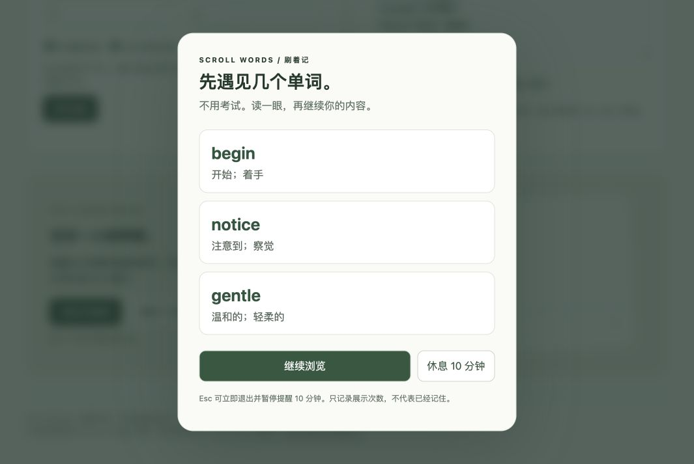

# Scroll Words · 刷着记

**A few words between scrolls. 在刷内容的间隙，遇见几个单词。**

[互动演示 / Try the demo](https://608tt.github.io/scroll-words/) · [下载扩展 ZIP](https://608tt.github.io/scroll-words/scroll-words-extension.zip) · [English](#english) · [验证记录](docs/validation.md)



开始背单词很难，先看见单词可以很简单。Scroll Words 是一个免费的桌面浏览器扩展：在**抖音、小红书网页版**浏览时，隔几条内容或一段前台停留时间，暂停一下，展示你自己词库里的英文与中文释义。

它不要求考试，不把展示次数当作学习效果，也没有账号和付费接口。当前为 **v0.1.0 预览版**：弹窗与词库已验证，真实站点改版可能影响内容计数，建议保留时间兜底。

## 能做什么

- 每次展示 **1–5 个词**，至少展示 **0–30 秒**，然后点击继续。
- 每浏览 N 条内容、每停留 N 秒，或两者先到先提醒。
- CSV / TSV / JSON 导入自选词库；英文重复项自动合并；导出 JSON。
- 顺序轮换覆盖词库，不在同一批次重复抽同一个词。
- 前台可见且获得焦点时才计时；弹窗期间暂停网页视频。
- 暂停 10 分钟、Esc 紧急退出、站点开关与总开关。
- 数据保存在 `chrome.storage.local`；不上传词库，不记录浏览历史，无统计 SDK。

<a id="install"></a>
## 安装：大约一分钟

1. [下载扩展 ZIP](https://608tt.github.io/scroll-words/scroll-words-extension.zip)，解压，得到 `scroll-words` 文件夹。
2. Chrome 打开 `chrome://extensions`；Edge 打开 `edge://extensions`。
3. 开启「开发者模式」，点击「加载已解压的扩展程序」，选择含有 `manifest.json` 的 `scroll-words` 文件夹。
4. 点击扩展图标 →「词库与提醒设置」。导入自己的词库并保存。
5. 打开或刷新 `https://www.douyin.com/` / `https://www.xiaohongshu.com/`。默认每 5 条内容或 180 秒提醒，3 个词、5 秒。

无需 Node、Python 或构建步骤即可安装扩展。也可下载 GitHub 的源码 ZIP，加载里面的 `extension` 文件夹。尚未上架 Chrome Web Store；浏览器可能显示开发者扩展提示。

**演示网页只演示效果，不会控制其他标签页。** 演示词库与扩展词库独立保存，可用导出/导入迁移。

## 自选词库

最简单的 CSV：

```csv
word,meaning
begin,开始；着手
notice,注意到；察觉
persist,坚持；持续
"take a break","休息一下,暂停片刻"
```

支持制表符分隔的两列，也支持 JSON：

```json
[{"word":"curious","meaning":"好奇的"}]
```

最多 5000 个词，文件最多 3 MB。英文最多 120 字符，释义最多 500 字符。格式错误会拒绝整个导入，保留原词库。这里只展示你提供的释义，不内置整套商业词典或盗版考试词库。12 个入门示例词及简短释义为本项目编写。

## 实现范围

| 场景 | 当前状态 |
| --- | --- |
| 桌面 Chrome / Edge 网页 | MV3 扩展；Chrome 组件与内容脚本夹具已测，Edge 待实机验证 |
| 抖音视频切换 | 用可见视频与视频地址识别，去重并等待 1.5 秒稳定；未完成真实站点扩展安装端到端验证 |
| 小红书瀑布流 / 笔记 | 用可见笔记链接或详情地址识别；同样为启发式计数 |
| 手机抖音 / 小红书 App | **不支持**；浏览器扩展无法直接插入原生 App |
| Android 悬浮窗 | 后续独立路线，需要系统授权和专门实机测试 |
| iOS 原生 App 内插卡 | 没有通用公开扩展入口；不能承诺与电脑版相同 |

不需要接入平台账户或私有 API 才能在用户自己的浏览器页面插入提醒；这不表示获得平台合作或背书。完整技术比较见 [可行性研究](docs/feasibility.md)。

计数不是观看完成检测：预加载、源地址变化、虚拟列表和站点改版都可能影响次数。第一次进入一条内容也计数，最近 100 条去重。每个标签页独立累计，刷新会重置浏览计数和暂停时间；词库和设置保留。后台不累计提醒时间。系统原生全屏、画中画和其他域名不保证能覆盖。

## 本地开发

```sh
git clone https://github.com/608tt/scroll-words.git
cd scroll-words
npm test
npm run build
npm run dev
```

开发需要 Node.js 22+；打包 ZIP 需要 Python 3。没有 npm 依赖，**不用 `npm install`**。本地演示地址为 `http://127.0.0.1:4175`。`dist/scroll-words-extension.zip` 是打包产物。

## English

Scroll Words adds small vocabulary breaks to **desktop Douyin and Xiaohongshu web pages**. Bring your own English–Chinese word list, choose a viewing/time interval, and see 1–5 words before continuing. It is a local Manifest V3 extension with no account, server, analytics or model API.

Download the extension ZIP above, unzip it, then use **Load unpacked** in Chrome/Edge's extension manager. Load the directory containing `manifest.json`. Reload supported tabs after installation. The hosted page is an interactive demo, not a cross-tab controller.

This preview uses heuristic content counting and a foreground-time fallback. Native mobile apps are not supported. Exposure is not evidence of memorization. See the [validation record](docs/validation.md), [privacy note](PRIVACY.md), and [feasibility study](docs/feasibility.md) for tested scope and limitations.

MIT © 608tt. Independent project; not affiliated with Douyin or Xiaohongshu.
